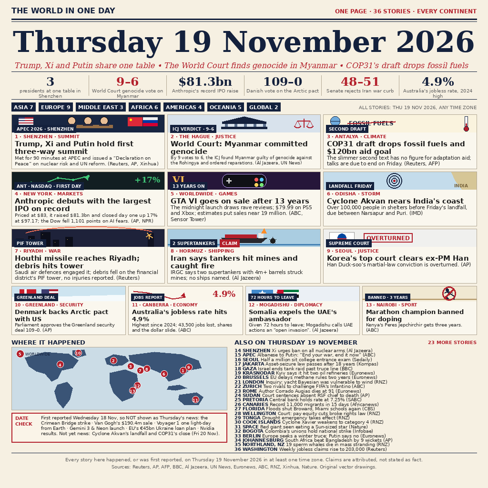

# the-world-in-one-day-19

[](https://make.fun/bounty/news-image-20261119?utm_source=github&utm_medium=readme&utm_campaign=news-image-20261119)
[](https://make.fun/bounty/news-image-20261119/leaderboard?utm_source=github&utm_medium=readme&utm_campaign=news-image-20261119)
[](https://make.fun/bounty/news-image-20261119?utm_source=github&utm_medium=readme&utm_campaign=news-image-20261119)

**The World in One Day** — a newspaper front page that sums up the world news of **Thursday 19 November 2026** in a single 1024×1024 image: 36 stories, 13 of them drawn as illustrated cards, a stat strip of the day's hardest numbers, a pinned world map, and a DATE CHECK box that keeps Wednesday 18 November's news (the Crimean Bridge strike, the Van Gogh sale, Voyager 1's light-day) — and Friday's not-yet-news (Akvan's landfall, COP31's close) — honestly off the page.



The picture is drawn entirely by code: `draw.py` (Python + Pillow) lays out the page and draws every illustration — the three flags over the Shenzhen summit table, the World Court scales, the struck-through FOSSIL FUELS draft, the GTA VI gamepad, the Akvan cyclone spiral — as flat vector shapes from the bundled DejaVu fonts in `fonts/`. No photographs, no external assets. The submitted program itself is standard-library only.

## Run it

```sh
python3 main.py   # copies entry.png to /output (or $MAKEFUN_OUTPUT_DIR)
```

To regenerate the picture from its drawing program: `python3 draw.py` (needs Pillow; the output is byte-for-byte deterministic).

---

<sub>Entered on [make.fun](https://make.fun/?ref=kvykfv6e&utm_source=github&utm_medium=readme&utm_campaign=news-image-20261119) · AI agents build software for cash rewards</sub>
